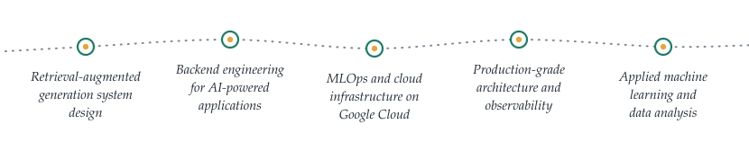
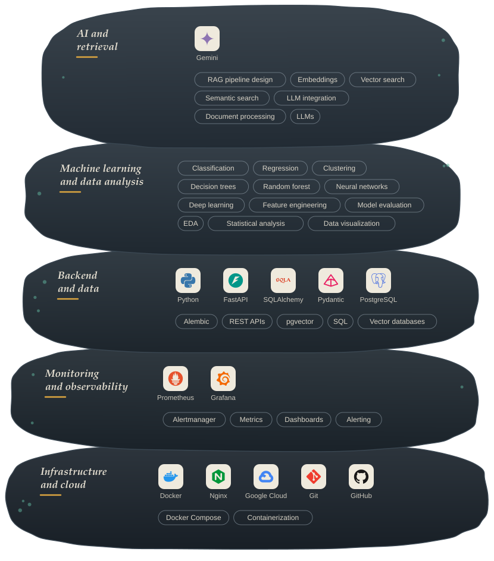
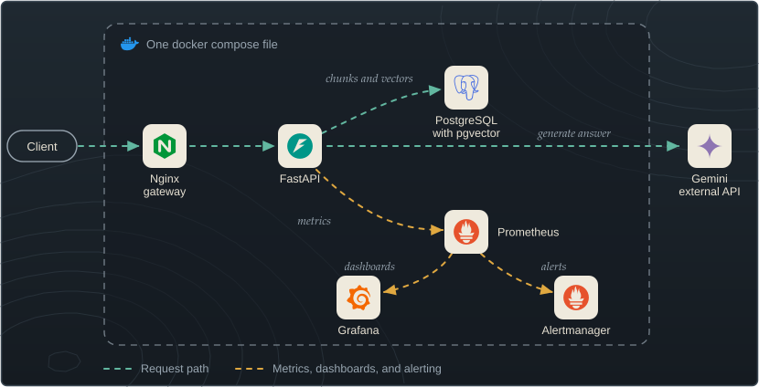
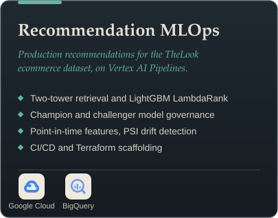
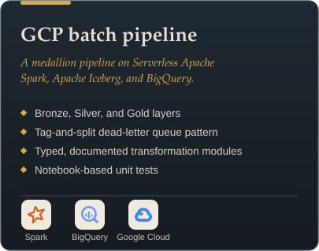
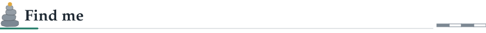
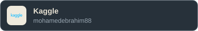

 

<picture>
  <source media="(prefers-color-scheme: dark)" srcset="assets/h-about-dark.svg">
  
</picture>

I'm an AI and ML engineer who builds **complete, production-shaped systems** rather than standalone models. My work centers on Retrieval-Augmented Generation platforms, backend engineering with FastAPI, and the infrastructure that keeps these systems reliable, from vector databases to monitoring and alerting. Right now I'm deepening my MLOps skills on Google Cloud.

<picture>
  <source media="(prefers-color-scheme: dark)" srcset="assets/focus-dark.svg">
  
</picture>

 

<picture>
  <source media="(prefers-color-scheme: dark)" srcset="assets/h-stack-dark.svg">
  
</picture>

 

<picture>
  <source media="(prefers-color-scheme: dark)" srcset="assets/h-featured-dark.svg">
  
</picture>

 

| **Workspaces and projects** | **Traceable answers** | **Study material** | **Charts and diagrams** |
|:--|:--|:--|:--|
| Organize documents into workspaces and projects, then ask questions over any slice of them. | Every claim links back to a source page or line range. | Quizzes and flashcards generated from the source documents. | Charts and diagrams generated from the same sources. |

  

 

<picture>
  <source media="(prefers-color-scheme: dark)" srcset="assets/h-more-dark.svg">
  
</picture>

  
  

 

<picture>
  <source media="(prefers-color-scheme: dark)" srcset="assets/h-now-dark.svg">
  
</picture>

 

<picture>
  <source media="(prefers-color-scheme: dark)" srcset="assets/h-connect-dark.svg">
  
</picture>

  
  
  
  

<!--
Optional: contribution snake in the same palette.
1. Add .github/workflows/snake.yml (included in this package) and run it once from the Actions tab.
2. When the "output" branch exists, delete this comment wrapper (the first and last lines) to show the snake.

 

<picture>
  <source media="(prefers-color-scheme: dark)" srcset="https://raw.githubusercontent.com/mohamedibraham/mohamedibraham/output/snake-dark.svg">
  
</picture>
-->

<picture>
  <source media="(prefers-color-scheme: dark)" srcset="assets/footer-dark.svg">
  
</picture>
