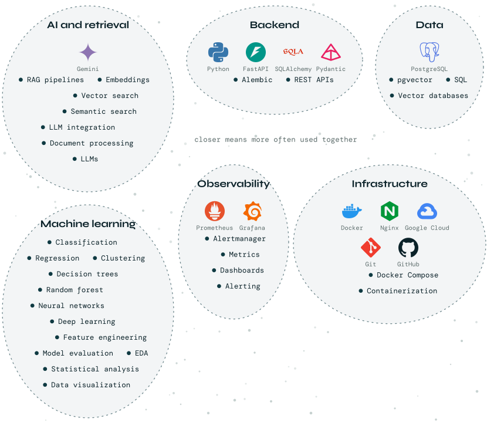
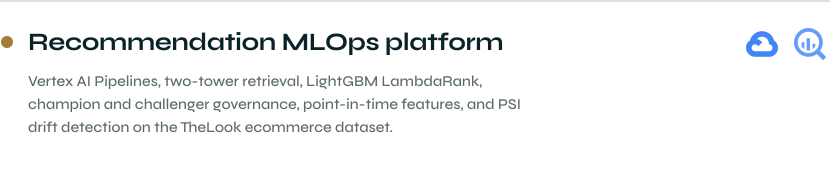
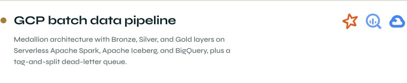

 

<picture>
  <source media="(prefers-color-scheme: dark)" srcset="assets/h-about-dark.svg">
  
</picture>

I'm an AI and ML engineer who builds **complete, production-shaped systems** rather than standalone models. My work centers on Retrieval-Augmented Generation platforms, backend engineering with FastAPI, and the infrastructure that keeps these systems reliable, from vector databases to monitoring and alerting. Right now I'm deepening my MLOps skills on Google Cloud.

 

<picture>
  <source media="(prefers-color-scheme: dark)" srcset="assets/h-stack-dark.svg">
  
</picture>

<picture>
  <source media="(prefers-color-scheme: dark)" srcset="assets/stack-dark.svg">
  
</picture>

 

<picture>
  <source media="(prefers-color-scheme: dark)" srcset="assets/h-featured-dark.svg">
  
</picture>

  

 

<picture>
  <source media="(prefers-color-scheme: dark)" srcset="assets/h-more-dark.svg">
  
</picture>

<a href="https://github.com/mohamedibraham?tab=repositories">
<picture>
  <source media="(prefers-color-scheme: dark)" srcset="assets/row-recsys-dark.svg">
  
</picture>
</a>

<a href="https://github.com/mohamedibraham?tab=repositories">
<picture>
  <source media="(prefers-color-scheme: dark)" srcset="assets/row-batch-dark.svg">
  
</picture>
</a>

 

<picture>
  <source media="(prefers-color-scheme: dark)" srcset="assets/h-now-dark.svg">
  
</picture>

<picture>
  <source media="(prefers-color-scheme: dark)" srcset="assets/now-dark.svg">
  
</picture>

 

<picture>
  <source media="(prefers-color-scheme: dark)" srcset="assets/h-hello-dark.svg">
  
</picture>

  <a href="https://github.com/mohamedibraham"><picture>
  <source media="(prefers-color-scheme: dark)" srcset="assets/pill-github-dark.svg">
  
</picture></a>
  <a href="https://www.linkedin.com/in/mohamed-ai-engineer"><picture>
  <source media="(prefers-color-scheme: dark)" srcset="assets/pill-linkedin-dark.svg">
  
</picture></a>
  <a href="https://www.kaggle.com/mohamedebrahim88"><picture>
  <source media="(prefers-color-scheme: dark)" srcset="assets/pill-kaggle-dark.svg">
  
</picture></a>
  <a href="mailto:mohammed.abdelal.ai@gmail.com"><picture>
  <source media="(prefers-color-scheme: dark)" srcset="assets/pill-email-dark.svg">
  
</picture></a>

 

<picture>
  <source media="(prefers-color-scheme: dark)" srcset="assets/footer-dark.svg">
  
</picture>
